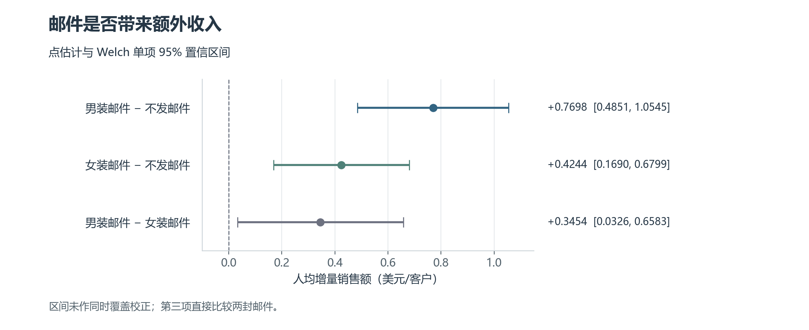
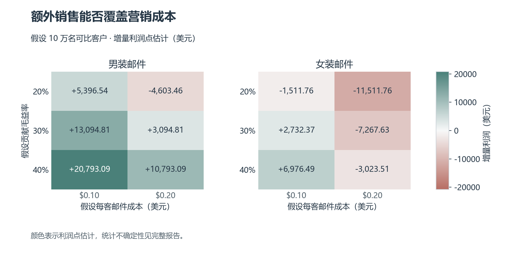

# Hillstrom 邮件营销随机实验

[](https://github.com/studing-endless/hillstrom-email-marketing-ab-test/actions/workflows/tests.yml)

*Hillstrom Email Marketing A/B/n Experiment*

发不发邮件、发哪封、给谁发，是零售商要作出的三个决定。即使不发邮件，有些客户也会回来购买。要判断营销预算是否值得投入，需要先区分自然购买和邮件带来的增量。本项目使用 Kevin Hillstrom 公开的 64,000 名既有客户随机实验，比较男装邮件、女装邮件和不发邮件在随后两周带来的访问、购买与销售差异。[原始挑战](https://blog.minethatdata.com/2008/03/minethatdata-e-mail-analytics-and-data.html)

## 从业务问题到经营判断

分析先检查随机分配与客户基线，再从访问率追踪到购买率及每名客户收入（RPC），用区间和多重比较评估证据，最后将增量收入换算为成本情景，并比较统一与分群投放的价值。

优先把统一男装邮件作为新随机试点候选，保留不发本次邮件的对照组，验证当前客户的真实增量。是否扩大投放取决于实际成本、贡献毛益、统计证据及退订等风险护栏。复杂分群暂缺可靠的额外收益证据。[营销试点与推广决策](docs/analysis-report.md#营销试点与推广决策)

## 邮件增加了多少收入

访问率领先仍不足以决定收入排序，需要看包含零消费客户的 RPC。女装邮件组的购买者平均花费更高，男装邮件组的购买率优势仍使其 RPC 更高。下图用对照差回答发不发，用两邮件直接比较回答发哪封。



两种邮件相对不发邮件均显示正向增量收入，男装邮件点估计较高，其相对女装邮件的优势仍存在不确定性。图中区间为未作同时覆盖调整的单项 95% 区间。下表列出的 P 值则对访问率、购买率、RPC 共九项比较统一进行 Holm 校正。

| RPC 比较（美元/客户） | 增量 | Welch 单项 95% CI | 九项 Holm P |
| --- | ---: | --- | ---: |
| 男装－不发 | +0.7698 | [0.4851, 1.0545] | 5.82e−7 |
| 女装－不发 | +0.4244 | [0.1690, 0.6799] | 0.002259 |
| 男装－女装 | +0.3454 | [0.0326, 0.6583] | 0.030469 |

两封邮件相对对照的收入证据在统一校正后仍成立。男装相对女装的估计优势更不确定，区间下限接近每客三美分。

## 多卖出商品以后，是否值得投放

增量销售额还要扣除销售相关可变成本和营销成本。沿用 10 万名可比客户、三档假设贡献毛益率和两档假设每客成本，检查财务条件变化会不会改变盈亏判断。



经济价值取决于增量收入、贡献毛益率和营销成本。某些情景下收入增量为正，利润点估计仍为负。热力图颜色表示假设利润点估计，统计显著性和盈利概率需分别评估。以 30% 毛益率、每客 0.10 美元成本为例，男装与女装利润点估计约为 13,095 和 2,732 美元，女装利润区间跨零。成本升至 0.20 美元时，男装利润区间也跨零。

## 是否需要按历史偏好选择邮件

用同一训练集分别选出统一发男装的规则 A 和按历史品类投放的规则 B，再用验证集原有的随机分组评价固定规则。B 只给仅买过女装的人换邮件，整体估计多 0.0106 美元/客户，Welch P = 0.9571，单项 95% 区间为 [−0.3757, 0.3969]。

历史品类直接关联邮件内容，已用 mens、womens 构建三个互斥群体，并检验品类、新老身份及渠道的响应差异。部分异质性线索尚未转化成规则收益证据。继续细分可能让每个单元格的实际购买样本更少，增加估计不确定性、规则选择风险和运营复杂度，因此暂不推荐复杂个性化。P = 0.9571 既不能证明过拟合，也不能证明两规则等效；当前评价具有探索性质，后续应在新数据中比较事先固定的候选规则。

**[阅读完整分析报告](docs/analysis-report.md)**，查看五阶段及第 5.5 节的完整业务推理与证据。[统计方法](docs/methodology.md) · [字段字典](docs/data-dictionary.md) · [统计质量与敏感性](docs/statistical-quality.md)

## 复现与文件导航

全量复现已在 Windows Python 3.13.6 隔离环境完成；Linux GitHub Actions 执行合成数据测试。核心计算依赖为 NumPy 2.2.6、pandas 2.2.3、SciPy 1.15.3、statsmodels 0.14.4，绘图使用 Matplotlib 3.10.7。

在仓库根目录执行以下命令，先安装稳定 Python 3.13，并按[数据获取说明](data/README.md)将 CSV 保存到 data/hillstrom.csv。

**Windows PowerShell**

```powershell
py -3.13 -m venv .venv
.\.venv\Scripts\python.exe -m pip install -r requirements.txt
.\.venv\Scripts\python.exe -m pytest -q
.\.venv\Scripts\python.exe -X utf8 analysis.py data/hillstrom.csv
.\.venv\Scripts\python.exe -X utf8 plot_figures.py data/hillstrom.csv
```

**macOS / Linux（bash 或 zsh）**

```sh
python3.13 -m venv .venv
./.venv/bin/python -m pip install -r requirements.txt
./.venv/bin/python -m pytest -q
./.venv/bin/python -X utf8 analysis.py data/hillstrom.csv
./.venv/bin/python -X utf8 plot_figures.py data/hillstrom.csv
```

绘图需要系统中文字体。Windows 本次使用 Microsoft YaHei；Linux 可安装 Noto CJK（Ubuntu/Debian 使用 `sudo apt-get install fonts-noto-cjk`），macOS 可使用系统 PingFang SC。macOS 命令尚未实机验证。缺少 CSV 时可以先运行测试，全量集成项会明确跳过；分析与绘图需数据就位。

| 文件 | 用途 |
| --- | --- |
| [analysis.py](analysis.py) | 五阶段计算、数据校验、SRM 与分层敏感性 |
| [plot_figures.py](plot_figures.py) / figures/ | 调用正式计算函数生成两张 200 DPI PNG |
| [tests/test_analysis.py](tests/test_analysis.py) | 合成测试、图像输出测试与可选全量集成复现 |
| [正式复现说明](docs/verification.md) | 已验证环境、执行命令、统计复核与范围 |
| [.github/workflows/tests.yml](.github/workflows/tests.yml) | Linux 合成测试和语法检查 |

主要限制包括历史人群与两周结果的可迁移性、假设成本与毛益、探索性样本拆分和少量非零消费。单项敏感性区间未控制全部探索的项目级错误率。原始数据未随仓库分发，公开 CI 不能代替原始 CSV 的全量复现。
